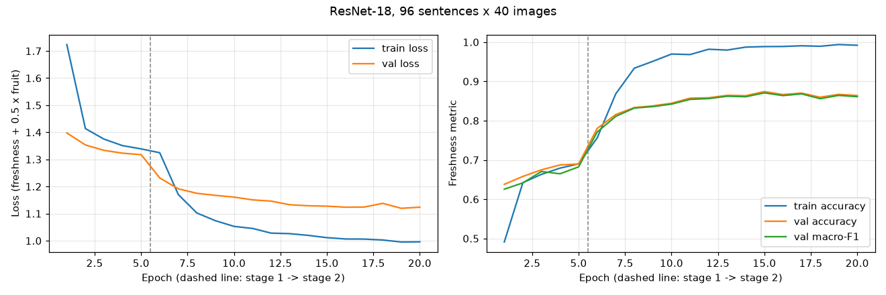
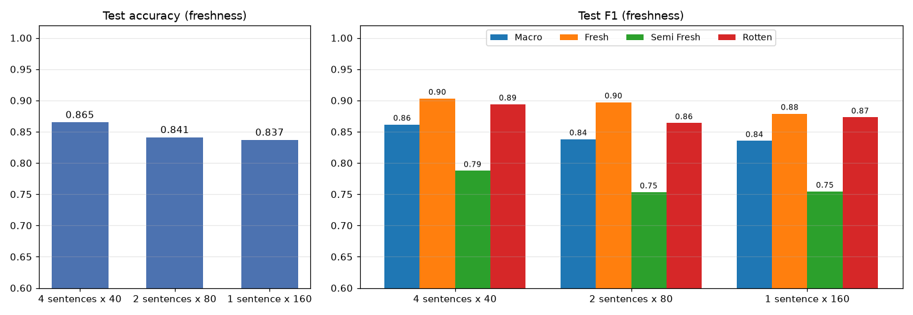
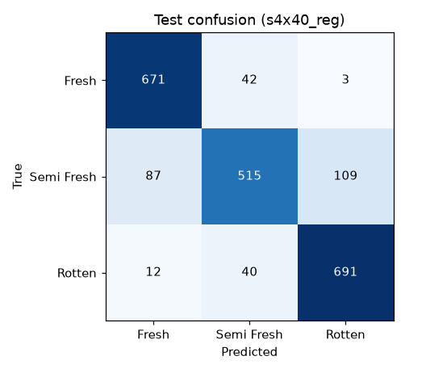

# Training & Experimentation

**Overview.** A VLM Selection Head (CLIP ViT-B/32) picks a labelling budget of 3,840 training images by
matching images to text descriptions of each class (4 sentences per class, 40 images per sentence,
round-robin). The selected images are labelled by an oracle (their true labels). An ImageNet-pretrained
ResNet-18 with two heads (freshness: 3 classes, fruit: 8 classes, auxiliary) is trained on them.
All metrics are reported for the 3 freshness classes (Fresh, Semi-fresh, Rotten).
Code: `train.py`, `summarize_runs.py`; outputs: `runs/`.

---

## 1. Training procedure

### 1.1 Train/validation/test methodology

**Random or temporal split?** Random. The data has no meaningful time order, and the goal is to
generalise to new photos, not future time periods. The split is seeded (seed 42) and saved, so every
run uses exactly the same split.

**How the split is made.**

1. The **original photos** of each class folder are split **70 / 15 / 15** into train, validation and
   test.
2. Each augmented copy (`aug_<n>_<original>`) is then placed in the same split as its original, so no
   photo, augmented or not, appears in more than one split. Byte-identical originals are treated as
   one group.
3. The selection head runs **only on the train split** and selects the 3,840 training images.

| Split | Original photos | Augmented copies | Total | Used for |
|---|---|---|---|---|
| Train pool | 3,642 | 6,217 | 9,859 | selection head picks 3,840 to train on |
| Validation | 777 | 1,311 | 2,088 | early stopping, checkpoint choice |
| Test | 781 | 1,389 | 2,170 | final evaluation (evaluated once) |

**Stratification for imbalance.** The split is made separately inside each of the 24 class folders
(8 fruits × 3 freshness levels), so every split keeps the same class proportions:

| Freshness | Validation | Test |
|---|---|---|
| Fresh | 705 | 716 |
| Semi-fresh | 674 | 711 |
| Rotten | 709 | 743 |

**Data cleaning before the split.** 17 photos that appeared identically in both *Fresh Orange* and
*Semi-fresh Orange* were removed from *Fresh Orange*, together with their 26 augmented copies.

### 1.2 Hyperparameter tuning approach

**Approach: manual.** No grid, random or Bayesian search was used. Hyperparameters were set from
standard practice for fine-tuning ImageNet-pretrained CNNs, with strong regularization because a
3,840-image budget is easy for an 11M-parameter network to memorise. The configuration is fixed across
all runs, so the ablation (§2.2) isolates the effect of the selection head.

**Final configuration (`v1.1`, seed 42):**

| Setting | Value |
|---|---|
| Model | ResNet-18 (ImageNet-pretrained), 11.2M parameters, two heads (dropout + linear) |
| Input preprocessing | resize 256×256 → centre crop 224 → ImageNet mean/std; no extra augmentation (data already augmented) |
| Loss | CE(freshness) + 0.5 × CE(fruit) |
| Stage 1 | heads only (backbone frozen), 5 epochs, AdamW lr 1e-3 |
| Stage 2 | `layer4` + heads (8.4M trainable parameters), AdamW lr 3e-5, cosine decay |
| Batch size / precision | 32 / mixed precision (fp16) |
| Weight decay | 0.05 |
| Dropout | 0.5 |
| Label smoothing | 0.2 |

### 1.3 Hardware & environment, epochs and early stopping

| Item | Value |
|---|---|
| GPU / VRAM | NVIDIA GeForce RTX 4050 Laptop / 6 GB |
| CPU | Intel Core i7-13620H (10 cores, 16 threads) |
| RAM | 16 GB |
| Software | Windows 11, Python 3.12, PyTorch 2.14.1 (CUDA 13.0), torchvision 0.29.1, transformers 5.18, scikit-learn 1.9 |
| Max epochs | 30 (5 in stage 1 + up to 25 in stage 2) |
| Early stopping criterion | validation freshness macro-F1, patience 5 epochs (stage 2); the best epoch's weights are restored |
| Final model run | stopped at epoch 20, best epoch 15, 169 s total (≈8.4 s per epoch), peak GPU memory 341 MB |

---

## 2. Results

### 2.1 Learning curves

*Figure 1. Loss (left) and freshness accuracy / macro-F1 (right) per epoch for the final model. The dashed
line marks the switch from stage 1 to stage 2. The loss includes label smoothing 0.2, so its minimum is
above zero.*

| Epoch | Stage | Train loss | Val loss | Train acc | Val acc | Val macro-F1 |
|---|---|---|---|---|---|---|
| 1 | 1 | 1.724 | 1.398 | 0.491 | 0.638 | 0.626 |
| 5 | 1 | 1.339 | 1.318 | 0.690 | 0.690 | 0.682 |
| 6 | 2 | 1.325 | 1.232 | 0.756 | 0.780 | 0.771 |
| 10 | 2 | 1.053 | 1.161 | 0.970 | 0.844 | 0.842 |
| **15 (best)** | 2 | 1.011 | 1.128 | 0.989 | **0.874** | **0.871** |
| 20 (stopped) | 2 | 0.996 | 1.124 | 0.992 | 0.864 | 0.861 |

**What the curves show:**
- **Stage 1 (frozen backbone):** validation macro-F1 rises slowly, from 0.63 to 0.68.
- **Stage 2 (`layer4` unfrozen):** validation macro-F1 climbs steadily and peaks at **0.871 at
  epoch 15**. Five epochs without improvement trigger early stopping at epoch 20.
- **Overfitting:** training accuracy approaches 0.99 while validation accuracy levels off near 0.87.
  The gap comes from the small training budget, so early stopping keeps the checkpoint where
  validation performance peaks.

### 2.2 Ablation / comparison

**What changes:** the number of text sentences per class in the selection head. The labelling budget
(3,840 images) and the training configuration stay the same. The 1- and 2-sentence variants use the
first one or two of each class's four sentences. **Baseline:** zero-shot CLIP with no training.

*Figure 2. Test accuracy (left) and test F1 (right) for each selection-head setup.*

| Setup | Sentences (total) | Images per sentence | Selection precision (class / freshness) | Test acc | Test macro-F1 | F1 Fresh | F1 Semi-fresh | F1 Rotten |
|---|---|---|---|---|---|---|---|---|
| Baseline: zero-shot CLIP | 96 | — | — | 0.545 | 0.526 | 0.494 | 0.394 | 0.691 |
| 1 sentence per class | 24 | 160 | 54.2% / 60.9% | 0.837 | 0.835 | 0.879 | 0.754 | 0.873 |
| 2 sentences per class | 48 | 80 | 55.4% / 61.7% | 0.841 | 0.838 | 0.897 | 0.753 | 0.864 |
| **4 sentences per class (final)** | 96 | 40 | **56.7% / 63.3%** | **0.865** | **0.862** | **0.903** | **0.788** | **0.894** |

**Findings:**
- **More sentences make the selection head more precise.** Class precision rises from 54.2% to 56.7%.
- **The final 4-sentence setup gives the best classifier.** Test macro-F1 is +2.3 points over 2
  sentences and +2.6 points over 1 sentence. The largest gain is on semi-fresh (F1 0.788 vs.
  0.753–0.754).
- **Training beats the zero-shot baseline by 31–34 points of macro-F1.**
- **Caveat:** a single seed was used, so differences of about 1 point should be treated as noise.

### 2.3 Class imbalance: mitigation and effect

**Is there imbalance?** The full dataset is balanced (≈590 images per class). Imbalance could appear in
the selected training set, because CLIP is better at matching some classes than others.

**Mitigation: sampling (a balanced selection budget).** The round-robin selection gives every sentence
exactly the same number of picks (40), so the budget is shared equally across the 24 classes. No
re-weighting or focal loss is used.

**Effect.**

| Setup | Fresh | Semi-fresh | Rotten | Smallest / largest fruit × freshness class |
|---|---|---|---|---|
| 1 sentence × 160 | 34.2% | 33.3% | 32.6% | 72 / 272 images |
| 2 sentences × 80 | 34.2% | 33.1% | 32.7% | 88 / 266 images |
| **4 sentences × 40 (final)** | **34.5%** | **32.2%** | **33.3%** | **92 / 271 images** |

- **Freshness is balanced:** every level is within 1.2 points of the ideal 33.3%, so the 3-class
  task needs no loss re-weighting.
- **Some imbalance remains between fruit × freshness combinations.** It narrows with more sentences:
  the smallest class grows from 72 to 92 images.

---

## 3. Task metrics (classification, final model)

Validation was used for model selection; the test set is fixed and was evaluated once.

### 3.1 Accuracy

| Split | Accuracy |
|---|---|
| Validation | 0.874 |
| **Test** | **0.865** |

### 3.2 Precision / recall (per class)

| Class | Val precision | Val recall | Test precision | Test recall | Test support |
|---|---|---|---|---|---|
| Fresh | 0.858 | 0.933 | 0.871 | 0.937 | 716 |
| Semi-fresh | 0.866 | 0.746 | 0.863 | 0.724 | 711 |
| Rotten | 0.897 | 0.937 | 0.861 | 0.930 | 743 |

### 3.3 F1 (per class, macro, micro)

| | Fresh | Semi-fresh | Rotten | **Macro-F1** | **Micro-F1** |
|---|---|---|---|---|---|
| Validation | 0.894 | 0.802 | 0.916 | 0.871 | 0.874 |
| **Test** | **0.903** | **0.787** | **0.894** | **0.862** | **0.865** |

### 3.4 AUROC / PR-AUC

| Split | AUROC (macro, one-vs-rest) | PR-AUC (macro) |
|---|---|---|
| Validation | 0.960 | 0.932 |
| **Test** | **0.955** | **0.925** |

### 3.5 Confusion matrix (test)

| True \ Predicted | Fresh | Semi-fresh | Rotten |
|---|---|---|---|
| Fresh | 671 | 42 | 3 |
| Semi-fresh | 87 | 515 | 109 |
| Rotten | 12 | 40 | 691 |

- **Semi-fresh is the hardest class** (recall 0.724). Its errors split between fresh (87) and rotten
  (109), because it is the visually ambiguous middle stage.
- **Fresh and rotten are almost never confused:** 15 errors out of 1,459 images.
